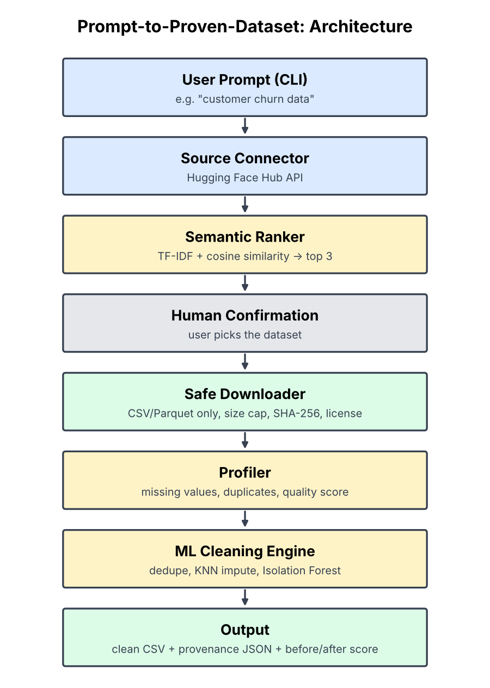

# From Prompt to Proven Dataset

A terminal tool that takes a plain-English request, finds a matching dataset on Hugging Face, downloads it safely, cleans it with ML, and saves a provenance report so every step is traceable.

> **Status: MVP / proof of concept** built for the Voyager Coding Club hackathon online round.

## Architecture



## What it does

1. **Search:** turns your prompt into keywords and queries the Hugging Face Hub API.
2. **Rank:** scores candidates against your prompt (TF-IDF + cosine similarity) and shows the top 3.
3. **Confirm:** nothing downloads until you pick a dataset.
4. **Safe download:** CSV/Parquet only, 50 MB size cap, SHA-256 hash, license shown.
5. **Profile:** counts missing values and duplicates and computes a quality score.
6. **Clean (asks first):** duplicate removal, KNN imputation, Isolation Forest outlier removal.
7. **Output:** a cleaned CSV and a provenance JSON (source URL, license, hash, steps, before/after quality).

## Install

```bash
pip install requests pandas scikit-learn pyarrow
```

## Usage

```bash
python dataset_agent.py "customer churn data"
```

Example flow:

```
[1] some-org/churn-dataset  (match 0.71)
[2] ...
Pick 1-3: 1
License: mit | Before: {...} | Quality: 92.4
Clean it? (y/n): y
Removed 12 duplicate rows
KNN-imputed missing numeric values
Quality: 92.4 -> 99.1
Saved: some-org_churn-dataset_clean.csv
```

## Output files

| File | Contents |
|---|---|
| `<dataset>_clean.csv` | Cleaned data |
| `<dataset>_clean_provenance.json` | Source URL, license, SHA-256, timestamp, cleaning steps, before/after stats |

## Security choices in this MVP

- Only the Hugging Face domain over HTTPS
- Safe formats only (CSV, Parquet); no pickle files
- File size limit
- File hash recorded for integrity
- User confirmation before download and before cleaning

## Limitations (honest list)

- Ranking uses TF-IDF on dataset names and tags, not full semantic embeddings.
- Only datasets that contain a plain CSV or Parquet file work.
- Cleaning is generic and does not understand each dataset's meaning.
- The quality score is a simple heuristic (missing values and duplicates).
- No PII detection, license enforcement, or sandboxing yet.

## Roadmap

- [ ] Embedding-based ranking (sentence-transformers) and LLM prompt parsing
- [ ] Augmentation (SMOTE, back-translation, image transforms)
- [ ] Benchmark: baseline model on raw vs cleaned data
- [ ] More sources (Kaggle, UCI, data.gov.in)
- [ ] PII detection and Docker sandboxing
- [ ] Web dashboard for reports

## License

MIT
